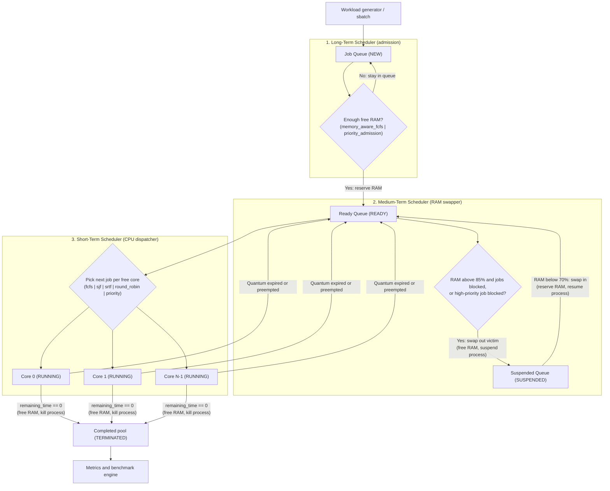
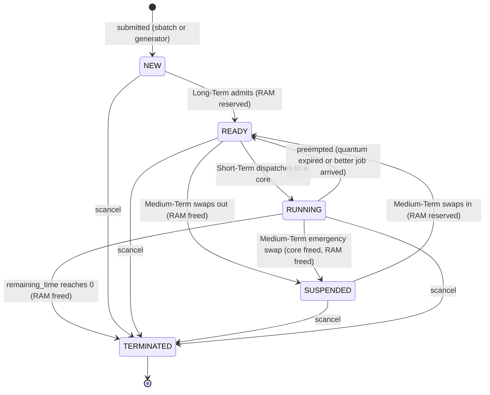
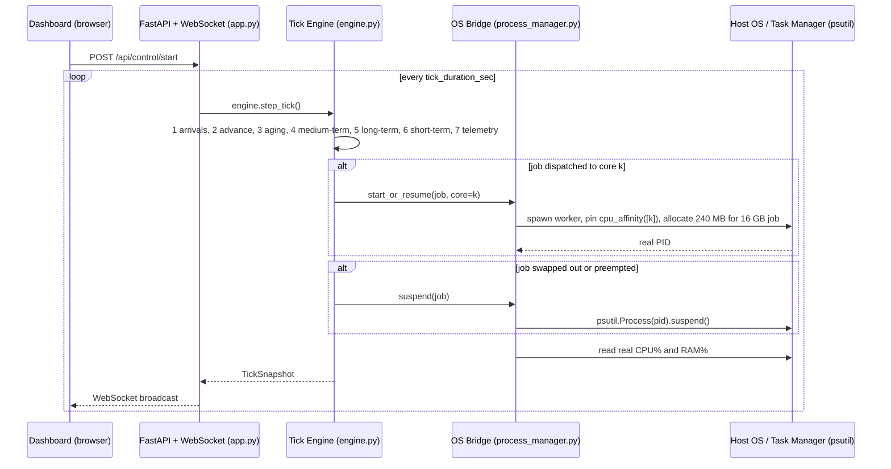

# Cloud Batch Job Scheduler Simulator: Authoritative Specification (`PROJECT_CONTEXT.md`)

> **Status:** v2.1 (Final Frozen Specification). This file is the single source of truth. If any other file disagrees with it, **this file wins**.
>
> **Audience**
> 1. **Team members:** understand the whole OS project, what each file does, and the exact interfaces you must implement.
> 2. **AI coding agents (Claude Code, Cursor, Copilot, Windsurf):** follow the data models, tick order, interfaces, and rules below strictly. Start with `CLAUDE.md`, then read this file.

## 0. Document map

| File | Read it when |
|---|---|
| `CLAUDE.md` / `AGENTS.md` | First. Short rules and commands for agents |
| `PROJECT_CONTEXT.md` (this file) | Always. Architecture, contracts, tick order, interfaces |
| `docs/API_CONTRACT.md` | Working on `app.py`, `cli.py`, or `dashboard/` |
| `docs/DASHBOARD_SPEC.md` | Working on `dashboard/` |
| `docs/TESTING.md` | Writing or running tests. Contains hand-verified golden results |
| `docs/TASKS.md` | Planning work. Per-member task lists and build order |
| `docs/DECISIONS.md` | Wondering why something is the way it is |
| `README.md` | Setup and demo instructions |

---

## 1. What are we building?

In HPC clusters (**Slurm**) and cloud batch systems (**AWS Batch**, **Kubernetes**), many batch jobs ask for CPU cores and RAM. One scheduler is not enough to keep the cluster healthy, so operating systems use **three-tier scheduling**:

1. **Long-Term Scheduler (admission controller).** Jobs arrive in the `NEW` queue. It admits a job to the `READY` queue only if the cluster has enough free RAM. It controls the degree of multiprogramming.
2. **Medium-Term Scheduler (RAM swapper).** When RAM is under pressure and jobs are blocked, it **suspends (swaps out)** a lower-priority job into the `SUSPENDED` queue, freeing its RAM at once. When RAM frees up, it **resumes (swaps in)** the job.
3. **Short-Term Scheduler (CPU dispatcher).** Runs every clock tick and assigns `READY` jobs to free CPU cores using **FCFS, SJF, SRTF, Round Robin, or Preemptive Priority (with aging)**.

**Syllabus coverage:** long, medium, and short-term schedulers; scheduling queues; scheduling criteria; multiprocessor operating systems.

### Dual-mode execution (what makes the project stand out)

| Mode | Purpose | Real OS processes? |
|---|---|---|
| **A. Benchmark mode** | Runs 50 to 100 seeded jobs through all 5 short-term policies in under 200 ms and produces comparison charts | No (`os_bridge.enabled = false`) |
| **B. Live OS mode** | When a job is dispatched, a real worker process is spawned, pinned to a real CPU core, given a scaled block of real RAM, and suspended or resumed with real OS calls. Evaluators can watch it in **Windows Task Manager** or `htop` next to our dashboard | Yes (`os_bridge.enabled = true`) |

Both modes use the **same engine** (`simulator/engine.py`). The OS bridge is an optional observer plugged into the engine. The simulation is always the source of truth; real processes only mirror it.

---

## 2. Visualizations

### 2.1 Three-tier scheduling pipeline



### 2.2 Job state lifecycle



### 2.3 Full-stack architecture and Task Manager bridge



---

## 3. Repository structure

```text
cloud_batch_scheduler/
├── CLAUDE.md                     # Agent entry point (short rules, commands)
├── AGENTS.md                     # Pointer for tools that look for AGENTS.md
├── PROJECT_CONTEXT.md            # This file (v2.1 authoritative spec)
├── README.md                     # Setup and demo guide
├── app.py                        # FastAPI server, REST, WebSocket loop
├── cli.py                        # Slurm-style CLI (thin HTTP client) + local benchmark
├── config.json                   # Default cluster and policy configuration
├── requirements.txt
├── docs/
│   ├── API_CONTRACT.md           # REST, WebSocket, TickSnapshot, CLI formats
│   ├── DASHBOARD_SPEC.md         # UI layout and behaviour
│   ├── TESTING.md                # Invariants, golden tests, manual checklist
│   ├── TASKS.md                  # Per-member task lists and build order
│   └── DECISIONS.md              # Resolved ambiguities and rationale
├── simulator/
│   ├── __init__.py
│   ├── job.py                    # Job, JobState, workload generator and loader
│   ├── cluster.py                # CPU cores, RAM accounting, Gantt history
│   ├── long_term.py              # memory_aware_fcfs, priority_admission
│   ├── medium_term.py            # suspend_lowest_priority, suspend_largest_memory
│   ├── short_term.py             # fcfs, sjf, srtf, round_robin, priority (+ aging)
│   └── engine.py                 # Discrete tick engine (both modes)
├── os_bridge/
│   ├── __init__.py
│   ├── process_manager.py        # Spawns and controls real worker processes
│   ├── worker.py                 # Child payload: allocate scaled RAM, spin CPU
│   └── host_monitor.py           # Real per-core CPU% and RAM% via psutil
├── metrics/
│   ├── __init__.py
│   ├── calculator.py             # Formulas from section 6
│   └── benchmark.py              # Runs all 5 policies on identical jobs
├── dashboard/
│   ├── index.html
│   ├── app.js
│   └── styles.css
└── tests/
    ├── test_schedulers.py
    ├── test_engine_invariants.py
    ├── test_metrics_golden.py
    ├── test_api.py
    ├── golden_workload.json      # 3-job hand-verified workload
    └── sample_jobs.json          # 15-job deterministic workload
```

---

## 4. Data contracts (strict)

### 4.1 `Job` and `JobState` (`simulator/job.py`)

Every module imports this exact structure. **Never rename or remove fields.** New fields may only be added here, with a note in `docs/DECISIONS.md`.

```python
from dataclasses import dataclass, field, asdict
from enum import Enum
from typing import Optional

class JobState(str, Enum):
    NEW = "NEW"
    READY = "READY"
    RUNNING = "RUNNING"
    SUSPENDED = "SUSPENDED"
    TERMINATED = "TERMINATED"

@dataclass
class Job:
    id: int                          # unique, e.g. 101
    name: str                        # e.g. "train-resnet"
    user: str                        # e.g. "alice"
    arrival_time: int                # tick when the job enters NEW
    burst_time: int                  # total CPU ticks needed (>= 1)
    memory_gb: int                   # simulated RAM (1 .. total_memory_gb // 2)
    base_priority: int               # 1 (highest) .. 5 (lowest)

    # dynamic runtime fields
    priority: int = field(init=False)         # current priority (aging may lower the number)
    remaining_time: int = field(init=False)
    state: JobState = JobState.NEW
    assigned_cpu: Optional[int] = None
    os_pid: Optional[int] = None              # Live OS mode only

    # timing and accounting
    admitted_time: Optional[int] = None
    first_run_time: Optional[int] = None
    finish_time: Optional[int] = None
    quantum_used: int = 0
    ready_wait_ticks: int = 0                 # ticks spent in READY + SUSPENDED (display only)
    age_counter: int = 0
    suspension_count: int = 0
    cancelled: bool = False                   # set by scancel (excluded from metrics)
    last_resumed_time: Optional[int] = None   # tick of last swap-in (anti-thrash rule)

    def __post_init__(self):
        self.priority = self.base_priority
        self.remaining_time = self.burst_time

    def to_dict(self) -> dict:
        d = asdict(self)
        d["state"] = self.state.value
        return d
```

**Workload generator rules** (`generate_workload(num_jobs, seed, total_memory_gb)`):

- Use `random.Random(seed)`. **Never** use the global `random`.
- IDs start at 101 and increase by 1.
- Arrival gaps: `randint(0, 2)` ticks. Burst: `randint(3, 15)`. Memory: `randint(4, min(16, total_memory_gb // 4))` for normal jobs, with about 15% "heavy" jobs up to `total_memory_gb // 2`. Priority: weighted toward 2 to 4.
- `memory_gb` must never exceed `total_memory_gb // 2`, otherwise a job may never fit.
- Users: `alice, bob, carol, dave`. Names: from a fixed list (`train-resnet`, `etl-spark`, `render-frames`, `log-parse`, `monte-carlo`, `backup`).
- Same `(num_jobs, seed, total_memory_gb)` always gives identical jobs.

### 4.2 `config.json` schema

```json
{
  "cluster": {
    "num_cpus": 4,
    "total_memory_gb": 64,
    "memory_suspension_threshold": 0.85,
    "memory_resume_threshold": 0.70
  },
  "schedulers": {
    "long_term_policy": "memory_aware_fcfs",
    "medium_term_policy": "suspend_lowest_priority",
    "short_term_policy": "round_robin",
    "time_quantum": 4,
    "aging_interval_ticks": 6,
    "min_residency_ticks": 3,
    "max_swaps_per_tick": 1
  },
  "os_bridge": {
    "enabled": false,
    "ram_scale_mb_per_gb": 15,
    "tick_duration_sec": 1.0,
    "max_total_real_ram_mb": 1024,
    "max_live_workers": 16
  },
  "workload": {
    "num_jobs": 20,
    "random_seed": 42
  },
  "server": {
    "host": "127.0.0.1",
    "port": 8000
  }
}
```

**Allowed policy names (exact strings):**

| Key | Values |
|---|---|
| `long_term_policy` | `memory_aware_fcfs`, `priority_admission` |
| `medium_term_policy` | `suspend_lowest_priority`, `suspend_largest_memory` |
| `short_term_policy` | `fcfs`, `sjf`, `srtf`, `round_robin`, `priority` |

### 4.3 Queue and memory invariants

- Queues are Python lists of `Job`. `ready_queue` is **FIFO by entry time**: new entries are appended at the tail.
- `cluster.used_memory_gb` equals the sum of `memory_gb` of jobs in state `READY` or `RUNNING`. `NEW`, `SUSPENDED`, and `TERMINATED` jobs hold **no** RAM.
- A job is on at most one core. A core holds at most one job.
- `0 <= used_memory_gb <= total_memory_gb` at all times.
- **Tie-breaking everywhere:** equal keys are broken by `arrival_time`, then `id`, both ascending (except `fcfs` and `round_robin`, which strictly use current position in `ready_queue`).

### 4.4 Order of operations in one clock tick (`engine.step_tick()`)

At tick `t` the engine **MUST** do the following in this exact order. First, apply pending external commands (`sbatch`, `scancel`) atomically; a submitted job gets `arrival_time = t`.

1. **Ingest arrivals.** Move jobs with `arrival_time == t` into `new_queue` (`state = NEW`), ordered by `(arrival_time, id)`.
2. **Advance running jobs** (work done during tick `t-1` to `t`). For each job on a core: `remaining_time -= 1`, `quantum_used += 1`. If `remaining_time == 0`: state `TERMINATED`, `finish_time = t`, `assigned_cpu = None`, release RAM (`cluster.release(job)`), vacate the core (`cluster.vacate(core)`), and terminate the OS process (`os_bridge.terminate(job)` in Live mode).
3. **Priority aging** (only when `short_term_policy == "priority"`). For every job currently in `ready_queue`: `age_counter += 1`; if `age_counter >= aging_interval_ticks` and `priority > 1`: `priority -= 1`, `age_counter = 0`.
   - **Aging state transition rule:** When a job is dispatched to `RUNNING` or swapped out to `SUSPENDED`, reset `job.age_counter = 0`. A job **keeps** its boosted `job.priority` even if later preempted or swapped out (it never reverts to `base_priority` during a run).
4. **Medium-term scheduler.** Run **swap-in first**, then swap-out (see 4.5).
   - **Emergency Running-Job Swap-Out Cleanup:** If a `RUNNING` job is selected as a swap-out victim in Step 4, the engine immediately calls `cluster.vacate(job.assigned_cpu)`, `cluster.release(job)`, sets `job.assigned_cpu = None`, `job.quantum_used = 0`, `job.age_counter = 0`, and calls `os_bridge.suspend(job)` **before** Step 5 runs, so its freed RAM and CPU core are immediately available in the same tick.
5. **Long-term scheduler.** Admit jobs from `new_queue` that fit: allocate RAM (`cluster.allocate(job)`), `state = READY`, `admitted_time = t`, `age_counter = 0`, append to tail of `ready_queue`.
6. **Short-term scheduler.**
   1. *Quantum check (`round_robin` only):* every running job with `quantum_used >= time_quantum` goes `RUNNING -> READY`, `assigned_cpu = None`, `quantum_used = 0`, `age_counter = 0`, core vacated, `os_bridge.suspend(job)`, and is appended to the **tail** of `ready_queue`.
   2. *Fill free cores:* for each free core in ascending order (`0 .. num_cpus-1`), pick the best job from `ready_queue` by the active policy. Remove from `ready_queue`, set `state = RUNNING`, `assigned_cpu = core`, `quantum_used = 0`, `age_counter = 0`, and `first_run_time = t` if `first_run_time is None`. Call `os_bridge.start_or_resume(job, core)` in Live mode.
   3. *Preemption (`srtf` and `priority` only):* repeat while `ready_queue` is non-empty and the best ready job is **strictly** better than the worst running job (`srtf`: smaller `remaining_time`; `priority`: smaller `priority` number; break ties among running victims by picking the one with the largest key, then latest `arrival_time`, then largest `id`). Swap them: the preempted running job goes to the **tail** of `ready_queue` (`state = READY`, `assigned_cpu = None`, `quantum_used = 0`, `age_counter = 0`, `os_bridge.suspend(victim)`, RAM stays reserved), and the better ready job takes its core (`state = RUNNING`, `assigned_cpu = core`, `quantum_used = 0`, `age_counter = 0`, `first_run_time = t` if `None`, `os_bridge.start_or_resume(better, core)`).
7. **Record telemetry.** Increment `ready_wait_ticks += 1` for all jobs currently in `READY` or `SUSPENDED`. Call `cluster.record_tick()` to append this tick's core allocation to `gantt`, plus `used_memory_gb`, busy cores, and queue lengths. Build the `TickSnapshot` (section 4.6). Finally, increment `self.tick += 1`.

Policy keys for choosing the best job from `ready_queue` (smaller is better):

| Policy | Selection Key | Preemptive |
|---|---|---|
| `fcfs` | index in `ready_queue` (FIFO order) | No |
| `sjf` | `(job.burst_time, job.arrival_time, job.id)` | No |
| `srtf` | `(job.remaining_time, job.arrival_time, job.id)` | Yes |
| `round_robin` | index in `ready_queue` (FIFO order, quantum `time_quantum`) | Yes (by quantum) |
| `priority` | `(job.priority, job.arrival_time, job.id)` | Yes |

### 4.5 Medium-term rules (the anti-thrash design)

**Swap-in** (runs first in Step 4, so suspended jobs beat new arrivals):
- While `cluster.memory_utilization < memory_resume_threshold` and `suspended_queue` is not empty:
- Pick the highest-priority suspended job using key `(job.priority, job.arrival_time, job.id)`.
- Swap it in **only if** `cluster.can_fit(job)` **and** `(cluster.used_memory_gb + job.memory_gb) / cluster.total_memory_gb <= memory_suspension_threshold`.
- If it fits: remove from `suspended_queue`, `cluster.allocate(job)`, `job.state = JobState.READY`, `job.last_resumed_time = t`, `job.age_counter = 0`, append to tail of `ready_queue`. (Note: its OS process stays suspended until the Short-Term Scheduler dispatches it to a core in Step 6). If the highest-priority suspended job does not fit, stop the swap-in loop for this tick.

**Swap-out** (at most `max_swaps_per_tick` victims per tick), only when jobs are actually blocked:
- Let `blocked_job` be the first candidate in `new_queue` (under the active Long-Term policy) that cannot fit in `cluster.available_memory_gb`. If `new_queue` is empty or the candidate already fits, **do not swap out anything**.
- **Trigger A (memory pressure):** `cluster.memory_utilization > memory_suspension_threshold` and `blocked_job` exists.
- **Trigger B (priority inversion block):** `blocked_job` has `priority <= 2` and cannot fit, and at least one eligible victim with `priority >= 4` exists.
- **Eligible victims:** Jobs in `ready_queue` whose `priority > blocked_job.priority` (strictly lower importance) and where `last_resumed_time is None or (t - last_resumed_time) >= min_residency_ticks`.
  - `suspend_lowest_priority` picks the victim maximizing `(job.priority, job.memory_gb, job.id)`.
  - `suspend_largest_memory` picks the victim maximizing `(job.memory_gb, job.priority, job.id)`.
- If no eligible victim exists in `ready_queue` and **Trigger B** applies, check `running` jobs with `priority >= 4` and eligible residency using the same victim key.
- **Effect:** Remove victim from `ready_queue` (or vacate core if `RUNNING`), `cluster.release(victim)`, `victim.state = JobState.SUSPENDED`, `victim.assigned_cpu = None`, `victim.quantum_used = 0`, `victim.age_counter = 0`, `victim.suspension_count += 1`, `os_bridge.suspend(victim)`, append to `suspended_queue`.

### 4.6 Inline `TickSnapshot` JSON contract

`engine.step_tick()` and `engine.snapshot()` **MUST** return a Python `dict` matching this exact JSON structure so `app.py`, `cli.py`, and `dashboard/app.js` never disagree:

```json
{
  "tick": 12,
  "finished": false,
  "mode": "simulation",
  "config": {
    "long_term_policy": "memory_aware_fcfs",
    "medium_term_policy": "suspend_lowest_priority",
    "short_term_policy": "round_robin",
    "time_quantum": 4
  },
  "cluster": {
    "num_cpus": 4,
    "cores": [101, 102, null, null],
    "used_memory_gb": 28,
    "available_memory_gb": 36,
    "total_memory_gb": 64,
    "memory_utilization": 0.4375,
    "suspension_threshold": 0.85,
    "resume_threshold": 0.70
  },
  "queues": {
    "new": [105],
    "ready": [103, 104],
    "running": [101, 102],
    "suspended": [],
    "terminated": [100]
  },
  "jobs": [
    {
      "id": 101,
      "name": "train-resnet",
      "user": "alice",
      "arrival_time": 0,
      "burst_time": 6,
      "remaining_time": 3,
      "memory_gb": 16,
      "base_priority": 2,
      "priority": 2,
      "state": "RUNNING",
      "assigned_cpu": 0,
      "os_pid": 18420,
      "admitted_time": 0,
      "first_run_time": 0,
      "finish_time": null,
      "quantum_used": 3,
      "ready_wait_ticks": 0,
      "age_counter": 0,
      "suspension_count": 0,
      "cancelled": false,
      "last_resumed_time": null
    }
  ],
  "events": [
    {"tick": 12, "scheduler": "MT", "job_id": 104, "message": "Swapped in JOB-104 (12 GB) -> READY"},
    {"tick": 12, "scheduler": "LT", "job_id": 103, "message": "Admitted JOB-103 (8 GB) -> READY"},
    {"tick": 12, "scheduler": "ST", "job_id": 101, "message": "Dispatched JOB-101 to Core 0"}
  ],
  "gantt_slice": [101, 102, null, null],
  "metrics": {
    "avg_waiting_time": 2.5,
    "avg_turnaround_time": 7.5,
    "avg_response_time": 1.0,
    "cpu_utilization": 68.75,
    "memory_utilization": 43.75,
    "throughput": 8.33,
    "starvation_count": 0,
    "suspensions": 0,
    "avg_queue_length": 1.8,
    "max_queue_length": 4,
    "jobs_completed": 1,
    "total_ticks": 12
  },
  "host": {
    "cpu_percent_per_core": [24.0, 18.5, 5.0, 12.0],
    "ram_percent": 61.2,
    "ram_used_mb": 9800,
    "active_workers": 2,
    "suspended_workers": 0
  }
}
```

---

## 5. Python interface contracts (signatures agents must implement)

```python
# simulator/job.py
def generate_workload(num_jobs: int, seed: int, total_memory_gb: int) -> list[Job]: ...
def load_workload(path: str) -> list[Job]: ...            # reads tests/*.json format
def clone_jobs(jobs: list[Job]) -> list[Job]: ...          # fresh copies with reset runtime state

# simulator/cluster.py
class Cluster:
    def __init__(self, num_cpus: int, total_memory_gb: int,
                 suspension_threshold: float = 0.85, resume_threshold: float = 0.70) -> None: ...
    cores: list[Optional[int]]            # job id per core, None if free
    used_memory_gb: int
    gantt: list[list[Optional[int]]]      # gantt[core][tick] -> job id or None
    memory_history: list[int]
    busy_history: list[int]
    queue_length_history: list[int]
    @property
    def available_memory_gb(self) -> int: ...
    @property
    def memory_utilization(self) -> float: ...             # 0.0 .. 1.0
    def can_fit(self, job: Job) -> bool: ...
    def allocate(self, job: Job) -> None: ...              # raises ValueError if it does not fit
    def release(self, job: Job) -> None: ...
    def free_cores(self) -> list[int]: ...                 # ascending
    def assign(self, job: Job, core: int) -> None: ...
    def vacate(self, core: int) -> None: ...
    def record_tick(self, total_queued: int = 0) -> None: ...

# simulator/long_term.py
def admit(new_queue: list[Job], cluster: Cluster, policy: str, now: int) -> list[Job]:
    """Remove admitted jobs from new_queue, allocate RAM, set READY/admitted_time, return them in order."""

# simulator/medium_term.py
def swap_in(suspended: list[Job], cluster: Cluster, now: int) -> list[Job]:
    """Remove resumed jobs from suspended, allocate RAM, set READY/last_resumed_time, return them."""

def swap_out(ready: list[Job], running: list[Job], new_queue: list[Job],
             cluster: Cluster, policy: str, now: int, cfg: dict) -> list[Job]:
    """Return suspended victims. Removes from ready/running, vacates core if running, frees RAM."""

# simulator/short_term.py
def age(ready: list[Job], interval: int) -> list[Job]:
    """Increment age_counter on ready jobs; boost priority when counter >= interval. Return boosted jobs."""

def quantum_preempt(running: list[Job], quantum: int) -> list[Job]:
    """Return jobs in running whose quantum_used >= quantum."""

def pick_next(ready: list[Job], policy: str) -> Optional[Job]:
    """Return best candidate in ready without removing it."""

def find_preemption(ready: list[Job], running: list[Job], policy: str) -> Optional[tuple[Job, Job]]:
    """Return (better_ready_job, worst_running_job) or None."""

# simulator/engine.py
class Engine:
    def __init__(self, config: dict, jobs: list[Job], os_bridge: "ProcessManager | None" = None) -> None: ...
    tick: int
    def step_tick(self) -> dict: ...                       # executes 7 steps and returns TickSnapshot
    def run_to_completion(self, max_ticks: int = 10_000) -> list[Job]: ...
    def submit(self, name: str, user: str, burst_time: int, memory_gb: int, priority: int) -> Job: ...
    def cancel(self, job_id: int) -> bool: ...
    def reset(self, config: dict | None = None, jobs: list[Job] | None = None) -> None: ...
    def snapshot(self) -> dict: ...
    @property
    def finished(self) -> bool: ...

# metrics/calculator.py
def compute_metrics(jobs: list[Job], cluster: Cluster, total_ticks: int) -> dict: ...

# metrics/benchmark.py
def run_benchmark(config: dict, jobs: list[Job] | None = None) -> dict[str, dict]:
    """Keys: fcfs, sjf, srtf, round_robin, priority. Each value is a compute_metrics dict."""

# os_bridge/process_manager.py
class ProcessManager:
    def start_or_resume(self, job: Job, core: int) -> None: ...
    def suspend(self, job: Job) -> None: ...
    def terminate(self, job: Job) -> None: ...
    def terminate_all(self) -> None: ...
    def status(self) -> list[dict]: ...                    # pid, rss_mb, core, status per job

# os_bridge/host_monitor.py
def sample() -> dict: ...    # {"cpu_percent_per_core": [...], "ram_percent": float, "ram_used_mb": int}
```

`Engine` must never import `psutil`. All real-OS code lives in `os_bridge/`. If `os_bridge` is `None`, no real process is touched.

---

## 6. Formulas (`metrics/calculator.py`)

For $N$ completed, non-cancelled jobs, $C$ cores, and $T_{\text{total}}$ = total elapsed ticks (or tick at which the last job terminated):

- **Turnaround Time:** $TAT_i = \text{finish\_time}_i - \text{arrival\_time}_i$
- **Waiting Time:** $WT_i = TAT_i - \text{burst\_time}_i$ (total time in `NEW`, `READY`, and `SUSPENDED`). Always computed from this exact formula. `ready_wait_ticks` is display-only.
- **Response Time:** $RT_i = \text{first\_run\_time}_i - \text{arrival\_time}_i$
- **CPU Utilization:** $100 \times \frac{\sum_{t=0}^{T_{\text{total}}-1} \text{busy\_cores}(t)}{C \times T_{\text{total}}}$
- **Memory Utilization:** $100 \times \frac{\text{mean}(\text{used\_memory\_gb}(t))}{\text{total\_memory\_gb}}$
- **Throughput:** $\frac{N}{T_{\text{total}}} \times 100$ (jobs per 100 ticks)
- **Starvation Count:** number of completed jobs with $WT_i > \max(3 \times \overline{WT}, 10)$
- **Average and Maximum Queue Length:** over $\text{len(new)} + \text{len(ready)} + \text{len(suspended)}$ per tick
- **Suspensions:** $\sum_i \text{job}_i.\text{suspension\_count}$

Return keys (exact): `avg_waiting_time, avg_turnaround_time, avg_response_time, cpu_utilization, memory_utilization, throughput, starvation_count, suspensions, avg_queue_length, max_queue_length, jobs_completed, total_ticks`. Round to 2 decimal places when serializing for JSON output, never inside intermediate calculations.

---

## 7. How the real OS link works (`os_bridge/`)

1. **Safe RAM scaling.** A job needing `memory_gb` GB allocates `memory_gb * ram_scale_mb_per_gb` MB for real (default 15, so 16 GB becomes **240 MB**). The sum over all live workers (running + suspended) must stay under `max_total_real_ram_mb` (default 1024 MB); if spawning a new worker would exceed `max_total_real_ram_mb`, clamp its allocation to `max(16, remaining_real_ram_mb // 2)`.
2. **Spawning.** Use `subprocess.Popen([sys.executable, "-m", "os_bridge.worker", "--job-id", str(int(job.id)), "--mem-mb", str(int(mb))])`. Arguments are built **only from integers**. Never pass user-provided strings to a subprocess.
3. **Worker payload.** Allocate `bytearray(mem_mb * 1024 * 1024)` and touch every 4096th byte so physical RAM is committed immediately in Task Manager. Then loop on light arithmetic (`math.sqrt`) for 30 ms followed by `time.sleep(0.02)` so CPU use is clearly visible in Task Manager without freezing the host UI. The worker never decides when a job finishes; the engine does.
4. **Core pinning.** `psutil.Process(pid).cpu_affinity([core % os.cpu_count()])`, wrapped in `try/except (AttributeError, psutil.AccessDenied, OSError): pass` (macOS has no affinity support).
5. **Real suspension.** `Process.suspend()` when a job leaves `RUNNING` (preempted, swapped out, quantum over) and `Process.resume()` when it is dispatched again. On Windows this appears as **Suspended** in Task Manager.
6. **Lifecycle mapping:**

| Engine event | Bridge call |
|---|---|
| First dispatch to core $k$ | spawn worker, pin to core $k$, record `job.os_pid` |
| Re-dispatch to core $k$ | `resume()` and re-pin to core $k$ |
| Preempt, quantum expire, or swap out | `suspend()` (process remains alive in OS in Suspended state) |
| Terminate or cancel | `terminate()` then `wait(timeout=2)`, fall back to `kill()`, set `job.os_pid = None` |
| Reset or server shutdown | `terminate_all()` (also registered with `atexit`) |

7. **Safety & Worker Caps.** Never more than `num_cpus` **actively running (unsuspended)** workers at any moment, and never more than `max_live_workers` (default 16) total spawned worker PIDs (including suspended ones). If a 17th worker would be spawned while 16 are already alive, terminate the oldest suspended worker PID first (it will transparently re-spawn when re-dispatched). Catch `psutil.NoSuchProcess` and `psutil.AccessDenied` everywhere.
8. **Real time vs ticks.** In Live mode one tick lasts `tick_duration_sec` of wall-clock time. Use small workloads (about 15–20 jobs, bursts of 3 to 15 ticks) so a live demo lasts 1–2 minutes.

---

## 8. External interfaces (summary)

Full details are in `docs/API_CONTRACT.md`.

- **REST** under `/api`: state, config, control (start, pause, step, reset), jobs (`sbatch`, `scancel`, `squeue`), nodes (`sinfo`), accounting (`sacct`), benchmark, mode switch.
- **WebSocket** `/ws`: broadcasts one `TickSnapshot` JSON per tick and immediately after any control/mutation action.
- **CLI** (`cli.py`): `sbatch`, `squeue`, `sinfo`, `sacct`, `scancel`, `benchmark`. Acts as a thin HTTP client against the running server; `benchmark` can also run locally without a server using `--local`.
- **Concurrency:** one `asyncio.Lock` guards the engine. The tick loop and all mutating endpoints acquire it, so `step_tick()` never runs concurrently with `submit()`, `cancel()`, or `reset()`.

---

## 9. Team split and dependencies

| Member | Role | Files | Key deliverables |
|---|---|---|---|
| **1** | Data model and long-term scheduler | `simulator/job.py`, `simulator/cluster.py`, `simulator/long_term.py`, `config.json`, `tests/*.json` | `Job`, generator, loader, `Cluster`, both admission policies |
| **2** | Short-term scheduler | `simulator/short_term.py`, `tests/test_schedulers.py` | 5 policies, aging, preemption, tie-breaking |
| **3** | Medium-term scheduler and engine | `simulator/medium_term.py`, `simulator/engine.py`, `tests/test_engine_invariants.py` | Swap policies, the 7-step tick engine, snapshot builder |
| **4** | OS bridge, server, and CLI | `os_bridge/*`, `app.py`, `cli.py`, `tests/test_api.py` | Real workers, affinity, suspend/resume, REST, WebSocket, Slurm CLI |
| **5** | Dashboard and analytics | `dashboard/*`, `metrics/*`, `tests/test_metrics_golden.py` | Web UI, Gantt, charts, formulas, benchmark |


**Day 1 rule:** Member 1 pushes `job.py`, `cluster.py`, and `config.json` first. Everyone else codes against those and uses stubs until real modules land. Detailed task lists are in `docs/TASKS.md`.

---

## 10. Rules for AI coding agents

**Must do**

1. Read `CLAUDE.md`, then this file, before writing code. Touch only the files assigned to the member you are helping (unless asked to build the full repo).
2. Use the exact names, signatures, JSON keys, and policy strings in this file.
3. Run `pytest -q` before saying a task is done. Add tests for every function you write.
4. Keep everything runnable with `python -m uvicorn app:app --reload`. No Redis, Celery, Docker, or external database.
5. Wrap `cpu_affinity` in the `try/except` from section 7. The project must run on Windows, Linux, and macOS.
6. Register an `atexit` handler and call `terminate_all()` on `engine.reset()` so no zombie workers remain.
7. Benchmarks deep-copy (`clone_jobs`) the same seeded jobs for each of the 5 policies and run with `os_bridge = None`, finishing in under 200 ms for 100 jobs.
8. Add type hints and a one-line docstring on every public function.
9. Seed all randomness through `random.Random(seed)`.

**Must not do**

1. Do not rename `Job` fields, policy strings, or JSON keys.
2. Do not import `psutil` outside `os_bridge/`.
3. Do not allocate real RAM above `max_total_real_ram_mb`, and never pass user strings to `subprocess`.
4. Do not change the tick order in section 4.4 or the golden results in `docs/TESTING.md` without updating `docs/DECISIONS.md`.
5. Do not invent benchmark numbers in docs or reports. Only report numbers the program produced.
6. Do not bind the server to anything but `127.0.0.1` by default.

---

## 11. Definition of done

- All five policies produce the exact golden results in `docs/TESTING.md`.
- All invariants in section 4.3 hold for every tick of a 100-job run (checked by `tests/test_engine_invariants.py`).
- Benchmark of 100 jobs over 5 policies finishes in under 200 ms.
- Live mode shows real worker processes appear, consume RAM, pin to cores, and turn **Suspended** in Task Manager when swapped out or preempted.
- Dashboard shows the three queues, per-core Gantt chart, RAM watermark graph, event log, policy comparison charts, and an embedded Slurm console.
- `pytest -q` passes. `README.md` demo script works on a fresh clone.

---

## 12. Glossary

| Term | Meaning |
|---|---|
| Tick | One discrete clock step of the simulation |
| Burst time | Total CPU ticks a job needs |
| Quantum | Maximum consecutive ticks a job runs under Round Robin |
| Swap out / in | Medium-term suspend / resume of a job, freeing / reserving its RAM |
| Preemption | Taking a core from a running job before it finishes |
| Aging | Raising a waiting job's priority over time to prevent starvation |
| Starvation | A job waiting far longer than others |
| Gantt chart | Timeline of which job ran on which core in each tick |