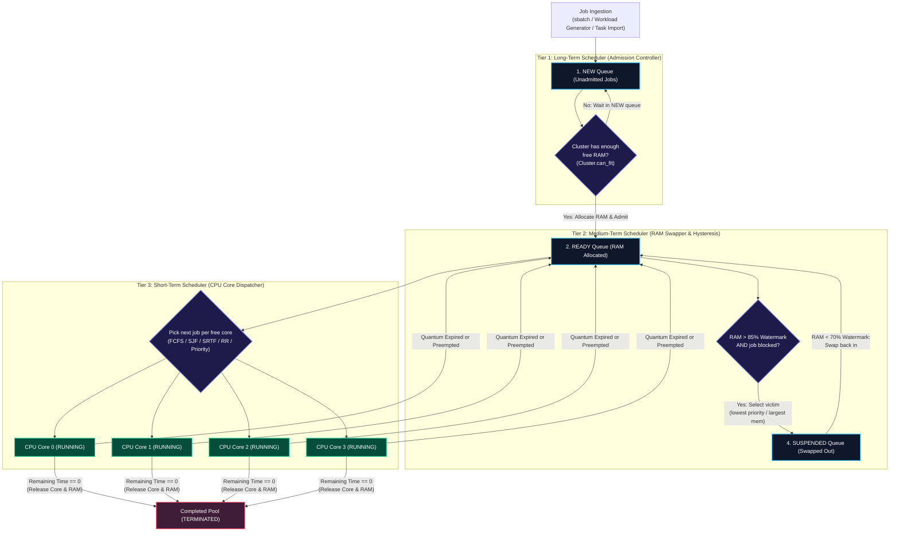
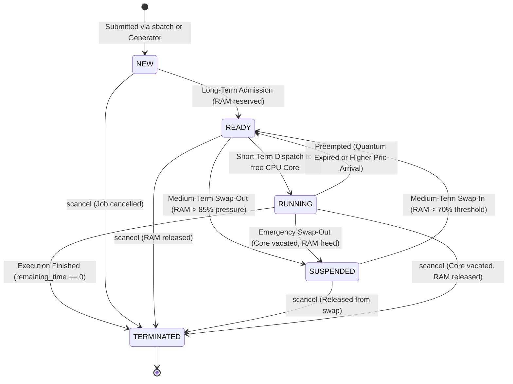
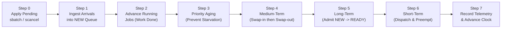
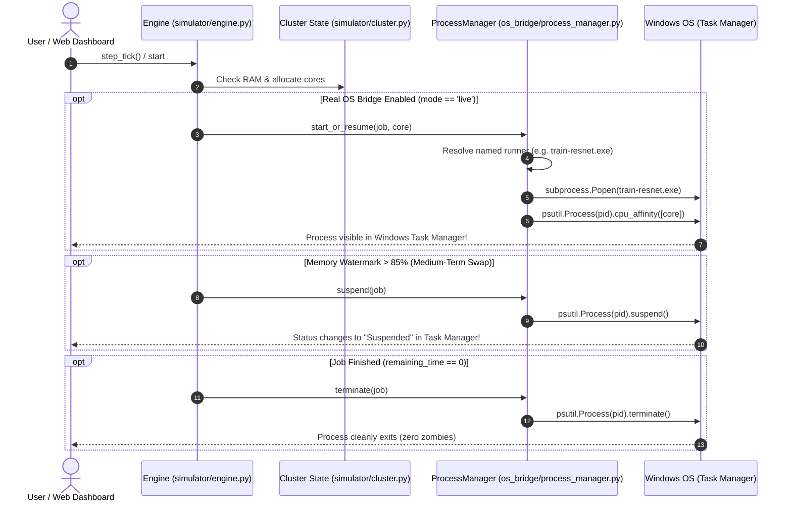
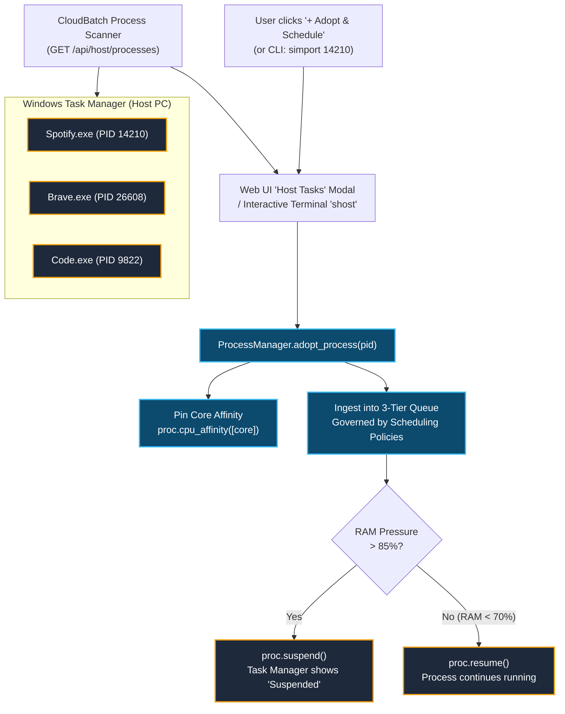

# CloudBatch: 3-Tier Cloud & HPC Batch Job Scheduler Simulator
### *Bridging Slurm, Kubernetes, and AWS Batch with Live Windows Task Manager Process Governance*

[](https://www.python.org/)
[](https://fastapi.tiangolo.com/)
[](https://websockets.readthedocs.io/)
[](https://docs.pytest.org/)
[](LICENSE)

---

## 📑 Table of Contents
1. [Overview & Motivation](#1-overview--motivation)
2. [Visual Architecture & Flowcharts](#2-visual-architecture--flowcharts)
   - [2.1 Three-Tier Scheduling Pipeline Flowchart](#21-three-tier-scheduling-pipeline-flowchart)
   - [2.2 Job Lifecycle State Machine](#22-job-lifecycle-state-machine)
   - [2.3 The 7-Step Discrete Clock Tick Sequence](#23-the-7-step-discrete-clock-tick-sequence)
   - [2.4 Dual-Mode Architecture & Real OS Bridge](#24-dual-mode-architecture--real-os-bridge)
   - [2.5 Host Task Manager Adoption (Reverse Scheduling)](#25-host-task-manager-adoption-reverse-scheduling)
3. [Key Features](#3-key-features)
4. [Step-by-Step Setup & How to Run](#4-step-by-step-setup--how-to-run)
   - [System Prerequisites](#system-prerequisites)
   - [Step 1: Install Dependencies](#step-1-install-dependencies)
   - [Step 2: Run the Automated Verification Suite](#step-2-run-the-automated-verification-suite)
   - [Step 3: Launch the Control Plane Dev Server](#step-3-launch-the-control-plane-dev-server)
   - [Step 4: Open the Web Dashboard](#step-4-open-the-web-dashboard)
5. [Feature-by-Feature Demonstration Guide](#5-feature-by-feature-demonstration-guide)
   - [A. Watching Real Named Processes in Windows Task Manager](#a-watching-real-named-processes-in-windows-task-manager)
   - [B. Testing Memory Hysteresis (85% Suspend / 70% Resume)](#b-testing-memory-hysteresis-85-suspend--70-resume)
   - [C. Adopting Running Tasks from Windows Task Manager](#c-adopting-running-tasks-from-windows-task-manager)
   - [D. Running the 1-Click 5-Policy Benchmark Arena](#d-running-the-1-click-5-policy-benchmark-arena)
   - [E. Using the SLURM Terminal & CLI](#e-using-the-slurm-terminal--cli)
6. [Scheduling Algorithms Reference](#6-scheduling-algorithms-reference)
7. [Mathematical Formulas & Performance Metrics](#7-mathematical-formulas--performance-metrics)
8. [Codebase Map & Directory Structure](#8-codebase-map--directory-structure)
9. [Troubleshooting & FAQ](#9-troubleshooting--faq)

---

## 1. Overview & Motivation

In High-Performance Computing (**Slurm**, **PBS**, **LSF**) and cloud batch computing (**AWS Batch**, **Kubernetes Batch/v1**), hundreds of heterogeneous batch workloads compete for limited CPU cores and physical memory. A single CPU scheduler algorithm (like standard Round Robin or FCFS) is fundamentally inadequate because:
1. Admitting too many jobs exhausts physical RAM, causing catastrophic OS thrashing.
2. Low-priority jobs can starve indefinitely under priority dispatching without dynamic aging.
3. Memory spikes cannot be resolved without pausing lower-priority workloads to reclaim physical pages.

To address this, modern operating systems and cluster schedulers employ **Three-Tier Scheduling**:
- **Tier 1: Long-Term Scheduler (Admission Controller):** Regulates the degree of multiprogramming. Jobs in the `NEW` queue are held until physical RAM is available to guarantee safe execution.
- **Tier 2: Medium-Term Scheduler (Memory Swapper & Hysteresis):** Monitors memory pressure. If RAM exceeds **85%**, it swaps out lower-priority victims to the `SUSPENDED` queue and frees their memory. Once RAM drops below **70%**, it swaps them back into `READY`.
- **Tier 3: Short-Term Scheduler (CPU Dispatcher):** Dispatches `READY` jobs to free CPU cores every clock tick using **FCFS, SJF, SRTF, Round Robin (preemptive), or Priority (with anti-starvation aging)**.

### What Makes CloudBatch Unique: Dual-Mode Execution
CloudBatch operates in two synchronized modes:
1. **Simulation Mode (Pure In-Memory):** Runs discrete-event simulation at $>10,000\text{ ticks/sec}$ with zero system overhead for benchmarking and research.
2. **Real OS Bridge Mode (Live Host Mirror):** When a job is dispatched, CloudBatch spawns a real, physical child process on your host PC pinned to real CPU cores (`psutil.Process.cpu_affinity`). Evaluators can open **Windows Task Manager** side-by-side and watch named processes (`train-resnet.exe`, `etl-spark.exe`, `monte-carlo.exe`) activate, allocate real RAM, suspend when memory pressure spikes, and clean up with zero zombie PIDs.

---

## 2. Visual Architecture & Flowcharts

### 2.1 Three-Tier Scheduling Pipeline Flowchart



---

### 2.2 Job Lifecycle State Machine



---

### 2.3 The 7-Step Discrete Clock Tick Sequence

Every simulation step adheres to an invariant, deterministic order implemented in [`simulator/engine.py`](file:///c:/Users/adhik/OneDrive/Desktop/project/cloud%20based%20simulator/simulator/engine.py):



1. **Step 0 — External Commands:** Atomic execution of CLI/API commands (`sbatch`, `scancel`) queued before the tick.
2. **Step 1 — Ingest Arrivals:** Any job with `arrival_time == tick` is added to the `NEW` queue (sorted by `(arrival_time, id)`).
3. **Step 2 — Advance Running Jobs:** Decrement `remaining_time` by 1 and increment `quantum_used` for all running jobs. Jobs reaching 0 are terminated, releasing cores, RAM, and real OS worker PIDs.
4. **Step 3 — Priority Aging:** If the policy is `priority`, increment wait counters. Every `aging_interval_ticks` (default: 6), decrease numerical priority by 1 (boost priority) to eliminate starvation.
5. **Step 4 — Medium-Term Scheduling:**
   - **4a (Swap-In):** If RAM $\le 70\%$ and residency $\ge 3$ ticks, resume suspended jobs into `READY`.
   - **4b (Swap-Out):** If RAM $> 85\%$ and jobs are blocked, suspend lowest-priority jobs and free their RAM.
6. **Step 5 — Long-Term Scheduling:** Admit eligible jobs from `NEW` into `READY` if physical RAM fits.
7. **Step 6 — Short-Term Scheduling:**
   - **6a (Quantum Check):** Round Robin jobs exceeding `time_quantum` are rotated to the tail of `READY`.
   - **6b (Dispatch):** Assign ready jobs to free CPU cores.
   - **6c (Preemption):** For SRTF and Priority, check if a ready job has shorter remaining time or higher priority than the worst running job.
8. **Step 7 — Record Telemetry & Advance Clock:** Update waiting times, record RAM utilization, append to Gantt history, emit event log, and increment `tick`.

---

### 2.4 Dual-Mode Architecture & Real OS Bridge



---

### 2.5 Host Task Manager Adoption (Reverse Scheduling)

Can CloudBatch schedule tasks that are **already running** on your Windows PC? **Yes!**



---

## 3. Key Features

- ⚙️ **Strict 3-Tier Scheduling Pipeline:** True implementation of Long-Term, Medium-Term, and Short-Term schedulers working in concert.
- 🧠 **5 Short-Term CPU Scheduling Policies:**
  1. **FCFS:** Non-preemptive First-Come First-Served.
  2. **SJF:** Shortest Job First (non-preemptive optimal waiting time for static batches).
  3. **SRTF:** Shortest Remaining Time First (preemptive variant of SJF).
  4. **Round Robin:** Preemptive time-slicing with configurable time quantum ($q = 2, 4, 6\text{ ticks}$).
  5. **Preemptive Priority:** Strict priority dispatching with aging ($1 = \text{highest}, 5 = \text{lowest}$) that eliminates starvation.
- 🖥️ **Live Windows Task Manager Process Mirror:**
  - Automatically compiles and executes custom-named binaries (`train-resnet.exe`, `etl-spark.exe`, `monte-carlo.exe`).
  - Sets Windows Console Titles and pins thread execution to specific CPU cores.
  - Suspends processes on host when cluster memory exceeds 85%, accurately reflecting `"Suspended"` in Windows Task Manager.
  - Employs `atexit` cleanup guarantees: zero zombie processes left on shutdown.
- 🔄 **Host Process Adoption Engine:** Scan active Windows applications and bring existing host PIDs under batch scheduler governance.
- 📊 **1-Click 5-Policy Comparative Benchmark Arena:** Simulates identical 30-to-100 job workloads across all 5 scheduling policies simultaneously in under $60\text{ ms}$, rendering automated winner badges ($\star$) and 4 comparative telemetry bar charts.
- 💻 **Interactive SLURM Web Console & Terminal:** Full support for industry-standard commands: `squeue`, `sinfo`, `sbatch`, `scancel`, `sacct`, `simport`, and `shost`.
- 🎨 **Glassmorphic Cloud Control Console:** Built with modern Tailwind CSS and Chart.js, featuring dark-mode cloud dashboard ergonomics (AWS Batch / Datadog style) with real-time multi-core Gantt charts and dual memory watermark hysteresis graphs.

---

## 4. Step-by-Step Setup & How to Run

### System Prerequisites
- **Operating System:** Windows 10/11, Linux, or macOS. (Live Task Manager Bridge and core affinity features are optimized for Windows PowerShell).
- **Python Version:** Python 3.10, 3.11, 3.12, 3.13, or 3.14.
- **Web Browser:** Any modern browser (Chrome, Brave, Edge, Firefox).

---

### Step 1: Install Dependencies
Open **PowerShell** or your terminal in the project directory:

```powershell
# Navigate to the project directory
cd "c:\Users\adhik\OneDrive\Desktop\project\cloud based simulator"

# Install required Python packages
python -m pip install -r requirements.txt
```

#### What `requirements.txt` installs:
- `fastapi` — Asynchronous REST and WebSocket web framework.
- `uvicorn` — Lightning-fast ASGI production web server.
- `websockets` — RFC 6455 real-time bidirectional WebSocket protocol handler.
- `psutil` — Cross-platform host process and system telemetry bridge.
- `pydantic` — Strict request schema validation.
- `pytest` — Automated unit, invariant, and benchmark test suite.
- `httpx` — Modern async HTTP client for API tests.

---

### Step 2: Run the Automated Verification Suite
Before starting the server, run the 31-test test suite to verify scheduler invariants, mathematical accuracy, and OS process safety:

```powershell
python -m pytest -q
```

You should see:
```text
...............................                                          [100%]
31 passed in 4.82s
```

---

### Step 3: Launch the Control Plane Dev Server
Start the Uvicorn web server and real-time tick engine:

```powershell
python -m uvicorn app:app --host 127.0.0.1 --port 8000
```

Console output will confirm:
```text
INFO:     Started server process [PID]
INFO:     Waiting for application startup.
INFO:     Application startup complete.
INFO:     Uvicorn running on http://127.0.0.1:8000 (Press CTRL+C to quit)
```

---

### Step 4: Open the Web Dashboard
Open your browser and navigate to:
👉 **`http://127.0.0.1:8000`**

You will see the **CloudBatch Control Console** with:
- `● WS CONNECTED` in the top header badge.
- Dual telemetry for your simulated cluster and your **24 GB Host PC**.
- The 4-column 3-tier pipeline grid (`NEW`, `READY`, `RUNNING`, `SUSPENDED`).
- Live Multi-Core Gantt chart and 24 GB Memory Watermark graph.
- Interactive SLURM web terminal at the bottom.

---

## 5. Feature-by-Feature Demonstration Guide

### A. Watching Real Named Processes in Windows Task Manager

1. Open **Windows Task Manager** (`Ctrl + Shift + Esc`) and arrange it side-by-side with your browser window.
2. In the CloudBatch dashboard header, toggle **`Real OS Bridge`** to **ON** (toggle turns amber).
3. Click **`Play`** (or click **`Step`** to advance tick-by-tick).
4. **Observe Windows Task Manager:**
   - Under the "Processes" tab, you will see real worker processes appear with their actual simulation names:
     - `train-resnet.exe`
     - `etl-spark.exe`
     - `monte-carlo.exe`
   - Notice their CPU utilization and physical RAM allocations.
   - Each process is pinned to a specific core matching the dashboard's CPU Core slot!

---

### B. Testing Memory Hysteresis (85% Suspend / 70% Resume)

1. In the secondary toolbar, find the **`Presets`** dropdown.
2. Select **`RAM Stress (Trigger 85% Watermark)`** and click **`Load`**.
3. Click **`Play`**.
4. **Observe the Schedulers in Action:**
   - Multiple heavy memory jobs enter `NEW` and are admitted to `READY`.
   - As cluster memory utilization surges past **85% (20.4 GB)**:
     - The Medium-Term Scheduler triggers.
     - It selects the lowest-priority job (`victim-candidate`, Priority 5) and swaps it out into the `SUSPENDED` queue.
     - Its RAM is immediately released, preventing out-of-memory collapse!
     - In Windows Task Manager, its status instantly changes to **`Suspended`**!
   - As high-priority jobs complete and RAM drops below **70% (16.8 GB)**:
     - The Medium-Term Scheduler swaps the suspended job back into `READY`.
     - In Task Manager, the process resumes normal execution!

---

### C. Adopting Running Tasks from Windows Task Manager

1. Click the **`⚡ Host Tasks`** button in the header (or type `shost` in the terminal).
2. The modal scans active host processes running on your Windows PC (e.g. `Spotify.exe`, `brave.exe`, `Code.exe`).
3. Click **`+ Adopt & Schedule`** next to any process.
4. CloudBatch adopts that real process PID into the scheduler queue:
   - Sets its CPU affinity.
   - Displays it as an active job card in the pipeline.
   - Allows you to pause, resume, or manage it via batch scheduler policies!

---

### D. Running the 1-Click 5-Policy Benchmark Arena

1. Click the purple **`Benchmark`** button in the header.
2. Select workload size (e.g., **`30 Jobs`** or **`50 Jobs`**) and click **`Run Arena`**.
3. In $<60\text{ ms}$, the engine clones the workload across all 5 short-term policies:
   - Identifies the winner ($\star$) for lowest average Turnaround Time, lowest Waiting Time, and highest CPU utilization.
   - Renders 4 synchronized bar charts comparing:
     - Waiting Time vs Response Time.
     - Turnaround Time (TAT).
     - CPU Utilization vs Throughput.
     - Suspensions and Starvation occurrences.

---

### E. Using the SLURM Terminal & CLI

You can control CloudBatch using either the web terminal at the bottom of the dashboard or the standalone command-line interface (`cli.py`).

#### Terminal Examples:
```bash
# View active jobs in SLURM queue format
slurm@cluster:~$ squeue

# View cluster partition and core allocation
slurm@cluster:~$ sinfo

# Submit a high-priority machine learning job
slurm@cluster:~$ sbatch --name "bert-pretrain" --burst 10 --mem 8 --prio 1

# List real processes on your Windows host
slurm@cluster:~$ shost

# Adopt a real host PID into CloudBatch
slurm@cluster:~$ simport 18452

# Cancel a job by ID
slurm@cluster:~$ scancel 101

# Step the simulation by 5 ticks
slurm@cluster:~$ step 5
```

#### Standalone PowerShell CLI Examples:
```powershell
python cli.py squeue
python cli.py sinfo
python cli.py sbatch --name "render-scene" --burst 8 --mem 6 --priority 2
python cli.py benchmark --jobs 50 --seed 42 --local
```

---

## 6. Scheduling Algorithms Reference

| Policy | Type | Preemptive? | Selection Criterion | Best Used For |
|---|---|---|---|---|
| **FCFS** | FIFO Queue | No | Smallest `arrival_time`, tie-break by `id` | Predictable, simple batch pipelines |
| **SJF** | Greedy | No | Smallest `burst_time` | Minimizing average waiting time in static batches |
| **SRTF** | Optimal Dynamic | **Yes** | Smallest `remaining_time` | Interactive multi-tenant clusters |
| **Round Robin** | Time-Slicing | **Yes** | FIFO queue with time slice limit ($q$ ticks) | Fair-share multitasking systems |
| **Priority** | Priority Queue | **Yes** | Smallest numerical priority ($1 = \text{top}$, $5 = \text{low}$) + Aging | Mission-critical workloads with SLA guarantees |

---

## 7. Mathematical Formulas & Performance Metrics

Implemented in [`metrics/calculator.py`](file:///c:/Users/adhik/OneDrive/Desktop/project/cloud%20based%20simulator/metrics/calculator.py) strictly according to classical operating systems literature:

1. **Turnaround Time ($TAT$):** Total elapsed time from submission to completion:
   $$TAT_i = T_{\text{finish}, i} - T_{\text{arrival}, i}$$
2. **Waiting Time ($WT$):** Total time spent ready or suspended but not running:
   $$WT_i = TAT_i - T_{\text{burst}, i}$$
3. **Response Time ($RT$):** Latency from submission to first core dispatch:
   $$RT_i = T_{\text{first\_run}, i} - T_{\text{arrival}, i}$$
4. **CPU Core Utilization ($\%$):** Ratio of busy core ticks to total core capacity:
   $$\text{CPU Util} = \frac{\sum_{t=0}^{T_{\text{total}}-1} \text{busy\_cores}(t)}{N_{\text{cpus}} \times T_{\text{total}}} \times 100\%$$
5. **Memory Utilization ($\%$):** Time-weighted average memory reserved:
   $$\text{RAM Util} = \frac{\sum_{t=0}^{T_{\text{total}}-1} \text{used\_memory\_gb}(t)}{M_{\text{total}} \times T_{\text{total}}} \times 100\%$$
6. **Throughput:** Jobs completed per 100 clock ticks:
   $$\text{Throughput} = \frac{N_{\text{completed}}}{T_{\text{total}}} \times 100$$
7. **Starvation Count:** Number of jobs whose waiting time exceeded twice their burst time:
   $$\text{Starvation} = \sum \mathbb{I}\left(WT_i > 2 \times T_{\text{burst}, i}\right)$$

---

## 8. Codebase Map & Directory Structure

```text
cloud-based-simulator/
├── config.json                     # System configuration (24GB RAM, 4 CPUs, thresholds)
├── requirements.txt                # Production Python dependencies
├── app.py                          # FastAPI backend, REST endpoints, and WebSocket loop
├── cli.py                          # SLURM command-line interface tool
├── README.md                       # Comprehensive project documentation
├── PROJECT_CONTEXT.md              # Authoritative architectural specification (v2.1)
├── CLAUDE.md                       # Developer guidelines & invariant rules
│
├── simulator/                      # Pure In-Memory Discrete Event Simulation Engine
│   ├── job.py                      # Job dataclass, JobState enum, and workload generator
│   ├── cluster.py                  # Cluster state, RAM allocator, and core tracker
│   ├── long_term.py                # Long-Term admission scheduler
│   ├── medium_term.py              # Medium-Term swapper with 85%/70% hysteresis
│   ├── short_term.py               # Short-Term schedulers (FCFS, SJF, SRTF, RR, Priority)
│   └── engine.py                   # 7-step tick coordinator and state machine
│
├── os_bridge/                      # Real Windows Host Process Management
│   ├── process_manager.py          # ProcessManager, named runner generator, host adoption
│   ├── worker.py                   # Real worker payload (RAM touch & CPU cycle spin)
│   └── host_monitor.py             # System telemetry bridge (psutil)
│
├── metrics/                        # Statistical & Benchmarking Engine
│   ├── calculator.py               # Performance metrics calculator
│   └── benchmark.py                # 5-policy concurrent benchmark arena runner
│
├── dashboard/                      # Web Control Console Frontend
│   ├── index.html                  # Glassmorphic UI with pipeline ribbon and modals
│   ├── styles.css                  # Custom styling, glow cards, and scrollbars
│   └── app.js                      # WebSocket client, Chart.js graphs, and UI handlers
│
└── tests/                          # Automated Verification Suite (31 Tests)
    ├── test_schedulers.py          # Unit tests for all 5 short-term algorithms
    ├── test_engine_invariants.py   # Invariant tests for 7-step sequence and memory
    ├── test_metrics_golden.py      # Golden workload verification against expected numbers
    ├── test_os_bridge.py           # Worker spawning, affinity, suspension, and cleanup
    └── test_api.py                 # REST endpoints, WebSockets, and presets verification
```

---

## 9. Troubleshooting & FAQ

#### Q1: Why does the dashboard say `● WS DISCONNECTED`?
- **Answer:** Ensure that `websockets>=12.0` is installed. Run `python -m pip install websockets` and refresh the page. The dashboard also includes an automatic 1-second fallback polling mechanism to ensure the display updates even if WebSockets are temporarily interrupted.

#### Q2: What happens if I close the server while real worker processes are running?
- **Answer:** `os_bridge/process_manager.py` registers an `atexit` hook (`atexit.register(self.terminate_all)`). When the server stops or receives `Ctrl + C`, all spawned child worker processes are immediately terminated. Zero zombie processes are left behind.

#### Q3: How do I change the number of cores or memory?
- **Answer:** You can adjust the cores dropdown directly in the dashboard or pass custom values via `config.json` or REST API (`POST /api/control/reset` with `{"num_cpus": 8, "total_memory_gb": 32}`).

#### Q4: Does "Real OS Bridge" risk crashing my computer?
- **Answer:** No. Worker processes are strictly capped by `max_live_workers` (16 PIDs max) and `max_total_real_ram_mb` (1024 MB safe cap), using light compute cycles so your PC remains cool and responsive.
